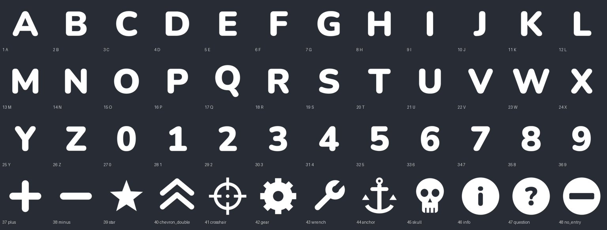

# Starship EVO More Decals

A BepInEx 5 mod that adds 48 built-in decals (letters A-Z, digits 0-9 and 12 symbols) and lets you add up to 12 of your own PNG decals. It adds **no new brick ids**: a modded decal is saved as one of the vanilla FACTION #1-#4 decals, so saves and blueprints still load for players without the mod.

> ⚠️ **NOT yet tested in-game (v0.1.0).** Game updates may break it. Back up your saves first.



## How to use

1. Press **F8** (config `PickerKey`) to open the More Decals window and click a decal. Pick **None** to go back to normal faction decals.
2. Select any **Codex > Decals > FACTION #1-#4** decal and build as usual. While a modded decal is selected, a line at the bottom of the screen shows its name.

The mod picks the right FACTION brick (#1-#4) for the decal by itself. Painting, resizing, rotating and symmetry work like on any other decal.

## Your own decals

Put PNG files in `BepInEx/plugins/MoreDecals/Custom/` (the folder is created on first start). They are loaded at game start and appear in the window after the built-ins.

- **Size and format:** PNG, ideally **256x256** RGBA. Other sizes are resized to 256x256. A white shape on a transparent background takes the paint color like vanilla decals. A colored image is multiplied by the paint color, so paint it white to keep its own colors.
- **Slots:** there are 12 custom slots. To choose the slot, start the file name with `01_` to `12_`, for example `03_mylogo.png`. Without a prefix the slot comes from a hash of the file name, so it is the same on every machine but two files can land on the same slot. When that happens, the second file (files with a prefix win, then alphabetical order) is **rejected** and a warning is written to the log. Rename it with a free prefix.
- What is saved in the ship is only the slot number, not the image. If you change which file is in a slot, every decal already placed in that slot changes too.
- **Other players need the same file with the same name** in their own `Custom` folder to see it. Without it they see the vanilla placeholder, and the log gets one warning per missing decal.
- The log lists every file it loaded (`[Custom] loaded 03_mylogo.png -> slot 03 (id 51).`) and every rejected file with the reason.

## What vanilla players (and players without the file) see

A modded decal is a normal **FACTION #1-#4 decal brick**, so they see that FACTION decal in the same place, size, rotation and color: the ship's faction logo if the ship has a faction with logos, or otherwise the gray "custom 1-4" placeholder. Nothing crashes, and the glyph comes back when the ship is opened again with the mod. Clicking, deleting and repainting work as normal. One limitation: clicking a modded decal uses the outline of the FACTION placeholder, not the glyph's shape.

## Multiplayer

The glyph number travels with the brick in the game's normal brick sync, so nothing extra is sent. Every player who wants to see the glyphs needs the mod, plus the same custom files for custom decals. Players without the mod can stay in the game and see FACTION decals instead.

## How it works (technical)

- **Storage:** the top 4 bits of `BrickInstanceData.scale` (a ushort). The game only uses bits 0-11 for the brick size (`Scale` / `PackScale`), but it saves the whole value (MessagePack key 2, so also in blueprints) and syncs it (Mirror `WriteUInt16`). There are 15 values on each of the 4 FACTION bricks (ids 309-312), so **60 variants**: 1-48 built-in, 49-60 custom.
- **Rendering:** at startup the vanilla voxel diffuse texture array is copied on the GPU into a bigger array with the glyphs added as extra layers, and that array replaces the `MAIN_TEX` shader global. The glyphs are converted to the array's format (RGBA32, DXT5 or BC7). A postfix on `DecalRendererResources.SetDecal` points modded decals at their layer and at a flat normal map. All of this runs on the main thread; no Burst code is patched.
- **Placing:** a prefix on `ActionBuild.LeftClickUp` writes the brick id and glyph bits. A patch on `EntitySymmetry.ApplySymmetry` keeps the glyph on mirrored copies.

## Config (`BepInEx/config/com.jammytoast.starshipevo.moredecals.cfg`)

| Section | Key | Default | Meaning |
|---|---|---|---|
| Decals | `Enabled` | `true` | Off: no patches; modded decals show the FACTION placeholder. |
| Decals | `PickerKey` | `F8` | Opens and closes the picker. |
| Debug | `VerboseLogging` | `true` | Logs extra details while placing decals. |

## Requirements and install

- Starship EVO (Steam) and [BepInEx 5.4.x](https://github.com/BepInEx/BepInEx/releases) (x64).
- Extract `MoreDecals-v0.1.0.zip` into the game folder, so you get `BepInEx/plugins/MoreDecals/MoreDecals.dll`.

## Check that it works

`BepInEx/LogOutput.log` should contain:

```
[Patch] Patch_ResourcesLoaderAwake applied.   (and 4 more)
MoreDecals 0.1.0 loaded, patched 5 methods. Built-in=48 custom=0 PickerKey=F8
[Inject] MAIN_TEX 256x256 layers=... format=... mips=...
[Inject] added 48 decal layers (...), normalId=...
```

If `[Inject]` reports an error (for example an unsupported texture format), modded decals keep the FACTION placeholder. Please report the line.

## Known limitations

- The picker is a separate F8 window, not a new section in the Codex Decals tab.
- The decal preview while placing shows the FACTION placeholder; the glyph shows once it is built.
- Clicks in the picker window may also reach the game behind it.

## Credits and license

- Mod code: MIT License, Copyright (c) 2026 JamMyTo4st (see `LICENSE`).
- Letter and digit glyphs are drawn with **Nunito** (Black weight), Copyright 2014 The Nunito Project Authors, under the **SIL Open Font License 1.1** (`tools/OFL-Nunito.txt`). Symbols are drawn with simple shapes. Regenerate them with `python3 tools/make_glyphs.py` (Pillow).
